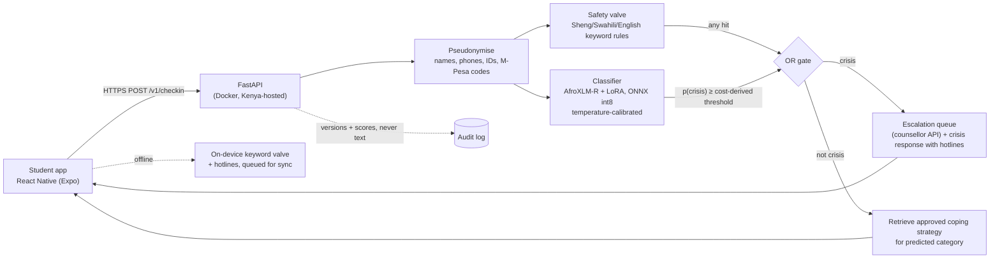

# Sikiza: Sheng-Aware Distress Triage and Coping Support

**Sikiza** (Swahili: "listen") is my DSA 8401 capstone. This repo is an end-to-end implementation of the proposal: a classifier for
English–Swahili–Sheng student check-ins that sends crisis messages to a human and answers every
other message with a **retrieved**, counsellor-approved coping strategy.

> **Status:** the code is complete and tested. It has run end to end on **synthetic demo data only**.
> No result here is a real result. Before any student uses it, three things must happen:
> real labelled data, counsellor approval of the library, and student/counsellor review of the lexicon.
> See "Before a pilot" below.

## Submission contents

| Deliverable | Where |
|---|---|
| Project overview, setup, architecture diagram, reproduction | this README |
| AI-use disclosure | [`AI_USE.md`](AI_USE.md) |
| Final report: problem framing, technique justification, results, limitations | [`REPORT.md`](REPORT.md) |
| Data pipeline (scripted, reproducible) | `triage/data.py`, `triage/augment.py`, `triage/pseudonymise.py`, `scripts/make_demo_data.py`, `scripts/augment.py` |
| Model training code | `triage/baseline.py`, `triage/transformer.py`, `triage/calibration.py`, `triage/thresholds.py`, `scripts/train_*.py`, `scripts/export_onnx.py` |
| Serialized artifacts | `artifacts/baseline/` (TF-IDF + LR, in the repo); int8 ONNX bundle in the [v0.1.0 release](https://github.com/Sheenaz/sikiza/releases/tag/v0.1.0) (`make model`, 279 MB, too large for git) |
| Evaluation outputs | `artifacts/reports/` (`eval.md`, `eval.json`, confusion matrices, fertility, drift) |
| Docker | `serving/Dockerfile`, `docker-compose.yml` |
| API service | `serving/app.py` (FastAPI) |
| Client app | `mobile/` (Expo React Native) |
| Tests and CI | `tests/`, `.github/workflows/ci.yml` |

## Architecture



Training side: seed check-ins → pseudonymise → grouped split by `seed_id` (train / calib / test) →
augment train only → baseline and LoRA fine-tuning → temperature scaling and threshold on calib →
ONNX int8 export, re-calibrated → evaluation on real (non-augmented) test messages only.

## Reproduce

Requirements: Python 3.11, Docker; Node 20+ only for the mobile app.

**A. Run the trained service (about 5 minutes)**

```bash
git clone https://github.com/Sheenaz/sikiza.git && cd sikiza
make model                      # download the int8 ONNX bundle from the release (SHA-256 checked)
docker compose up --build       # API on http://localhost:8000, interactive docs at /docs
curl -s -X POST localhost:8000/v1/checkin -H 'content-type: application/json' \
     -d '{"text":"nimechoka na exams, sijui kama nitapass"}'
```

**B. Rebuild everything from scratch (about 10–15 minutes on a laptop CPU)**

## Proposal → code map

| Proposal item | Where |
|---|---|
| Crisis + 5 categories | `configs/config.yaml` `labels`; two-head model in `triage/transformer.py` |
| Pseudonymise (names, numbers) | `triage/pseudonymise.py`, `data/lexicon/names.txt` |
| Safety valve: keywords **OR** classifier | `triage/safety_valve.py`, `data/lexicon/sheng_lexicon.yaml`, `triage/pipeline.py::decide` |
| Augmentation, variants keep seed ID, grouped splits | `triage/augment.py`, `triage/data.py` (`make_splits`, `assemble`) |
| Test on real messages only | `data.assemble`: augmented rows only join train; asserted in `scripts/evaluate.py` |
| TF-IDF + LR baseline | `triage/baseline.py`, `scripts/train_baseline.py` |
| Zero-shot NLI check | `scripts/zero_shot.py` |
| AfroXLM-R / XLM-R + LoRA, DistilBERT comparison | `triage/transformer.py`, `scripts/train_transformer.py --model afroxlmr\|xlmr\|distilbert` |
| HF intermediate fine-tuning (GoEmotions, AfriSenti, tabularisai) | `triage/hf_data.py`, `--intermediate` |
| Measure tokenizer fertility first | `scripts/fertility.py` |
| Temperature scaling on held-out split | `triage/calibration.py` |
| Cost-derived threshold (not 0.5) | `triage/thresholds.py` |
| Retrieval from approved library, never generated | `triage/retrieval.py`, `data/library/coping_library.yaml` |
| Recall ≥ 0.95 with bootstrap CI, macro-F1, confusion matrix, EN vs code-mixed, McNemar, Cohen's κ | `triage/evaluate.py`, `scripts/evaluate.py` |
| ONNX int8 | `triage/export.py`, `scripts/export_onnx.py` |
| FastAPI + Docker, versions logged, never the raw message | `serving/app.py`, `serving/Dockerfile`, `triage/audit.py` |
| Human handles every crisis | escalation queue + counsellor endpoints in `serving/app.py` |
| Offline safety valve in the app | `mobile/src/safetyValve.ts` (parity-checked against Python) |
| Monthly drift checks for new Sheng | `triage/drift.py`, `scripts/drift_report.py`, OOV counter in `triage/audit.py` |
| < 400 ms round trip | `scripts/benchmark_latency.py`; dev builds of the app show ms per check-in |

```bash
make setup          # Python venv (+ mobile deps)
make demo           # demo data → augment → baseline → AfroXLM-R (2 epochs) → ONNX int8 → evaluate
make distilbert DEMO=--demo && make evaluate DEMO=--demo   # comparison model + full results table
make test           # unit + API tests
make serve          # API on :8000 without Docker (draft library allowed in dev)
cd mobile && cp .env.example .env && npx expo start      # app; set EXPO_PUBLIC_API_URL in .env
```

Every script prints a **DEMO DATA** banner when it runs on the synthetic set.

## Running on the real Strathmore data

1. Put the consented, de-identified check-ins at `data/raw/strathmore_checkins.csv` (git-ignored).
   Columns: `seed_id, text, category, crisis, language` (+ `category_2, crisis_2` for the double-coded
   sample, which gives Cohen's κ). Use `en | sw | sheng | mixed` for `language`.
2. `python scripts/augment.py` (add `--back-translate` for MarianMT en↔sw round trips).
3. `python scripts/fertility.py`: record this before choosing the encoder.
4. `python scripts/train_baseline.py`
5. `python scripts/train_transformer.py --model afroxlmr --intermediate` (then `--model distilbert`)
6. `python scripts/export_onnx.py --src artifacts/afroxlmr_torch --out artifacts/model`
7. `python scripts/evaluate.py --bundles artifacts/baseline artifacts/afroxlmr_torch artifacts/distilbert_torch artifacts/model`
   gives `artifacts/reports/eval.md`, `eval.json` and the confusion matrices.
8. `python scripts/zero_shot.py`

Splits are fixed the first time (`data/processed/splits/splits.json`). The splits are never re-drawn once test results have been seen.

## Findings

The full discussion is in [`REPORT.md`](REPORT.md). In short:

1. **The success criterion needs more crisis examples than a random split gives.** A 95% CI lower bound
   ≥ 0.95 needs **≥ 72 test crises with zero misses** (exact Clopper–Pearson: 0.025^(1/n) ≥ 0.95).
   A random 25% test split of about 1,000 messages at about 5% prevalence holds about 12. With 12/12 caught,
   the lower bound is only 0.74. Options: enrich the test set with more real crisis messages (with
   ethics approval), use grouped k-fold to pool predictions across folds, or report the CI honestly. The
   evaluator reports both bootstrap and exact CIs and uses the more conservative one. The percentile
   bootstrap collapses to [1, 1] when every crisis is caught.
2. **The cost-derived threshold is very low.** C_fp/(C_fp+C_fn) = 1/101 ≈ 0.0099. A weak model then
   escalates almost everything. That happens on the demo data, and the report warns about it. Always
   report the escalation rate next to recall, because recall at a 100% escalation rate means nothing. If
   counsellor capacity binds, revisit the cost ratio with them rather than raising the threshold silently.
3. **Tokenizer fertility** (demo text): AfroXLM-R and XLM-R share a tokenizer, at 1.57 tokens per word on
   code-mixed text versus 1.18 on English. Multilingual DistilBERT gives 1.93, with 23.5% of words split
   into 3 or more pieces. This supports the proposal's encoder choice. Re-measure on the real data.
4. **int8 quantisation shifts logits.** The fp32 ONNX export matches PyTorch exactly. Dynamic int8
   (1.1 GB → 279 MB) moved crisis logits by up to about 1.3 on the demo model. The int8 bundle is
   therefore **re-calibrated, and its threshold re-derived, on its own calibration outputs**, and that
   bundle is what gets evaluated and deployed. Keeping the embedding layer in fp32 made the file 856 MB
   for little gain.
5. **Latency:** about 5 ms model-only and about 7.5 ms local HTTP round trip on an M1 CPU. The 400 ms
   budget is network-bound, as the proposal predicted. Measure on a mid-range Android phone with the app.
6. **The OR-gate matters.** On demo data the keyword valve alone catches 4/6 test crises. Implicit
   warning signs ("I've written goodbye letters…") are caught only by the classifier.
7. **Drift:** a TF-IDF embedding can't see words it has never seen, so novelty also counts the unseen-word
   rate. Injected new slang ("wueh", "mafala") is clustered and surfaced for review.

## Docker

```bash
make model                       # or train it yourself: make demo
docker compose up --build -d     # builds sikiza:0.1.0 and starts it on :8000
docker compose logs -f api       # startup warnings (draft library, unreviewed lexicon, demo model)
docker compose down              # stop (the state volume is kept)

# Production: create .env with ALLOW_DRAFT_LIBRARY=0 and a strong COUNSELLOR_API_KEY.
# The container then REFUSES to start until the library is approved.
# Kenya-hosted cloud VMs are usually x86, so build for that platform:
docker buildx build --platform linux/amd64 -f serving/Dockerfile -t sikiza:0.1.0-amd64 .
```

Only the files allow-listed in `.dockerignore` are sent to the build: no data, no venv, no torch checkpoint.

- Image: about 450 MB compressed (python:3.11-slim + onnxruntime + int8 model, no torch). It runs as non-root
  uid 10001, the model is read-only, and it has a built-in health check.
- State (prediction log + escalation SQLite) lives on the `/app/state` volume. Back it up and set its
  retention according to the ethics approval.
- Memory: about 1.4 GB with 2 uvicorn workers (each loads the model). Use `--workers 1` on small VMs.
- Measured on an M1 through Docker Desktop: p50 25 ms and p95 37 ms HTTP round trip.
- The image bakes in whatever is in `artifacts/model` at build time. Rebuild after every re-export,
  and check `GET /v1/version` shows the expected model, lexicon and library versions.

## Privacy and governance (DPA 2019)

- Pseudonymisation runs first, at data load and at serving time. Its limitation: names that aren't
  introduced ("my name is…") and aren't in `names.txt` survive. The gazetteer is to be extended from the real data.
- The prediction log (`artifacts/logs/predictions.jsonl`) holds versions, scores and rule IDs, **never text**.
- The escalation queue (SQLite) holds the **pseudonymised** text, because a counsellor needs it to act.
  It's behind `COUNSELLOR_API_KEY`. Set retention to match the ethics approval.
- The OOV counter shows a new token only after it appears in ≥ 5 requests (k-anonymity floor).
- Host the Docker image on Kenya-based infrastructure.
- The webhook (`ESCALATION_WEBHOOK`) sends only the escalation ID, never message content.

## Before a pilot (blocking)

- [ ] Counselling department approves every entry in `data/library/coping_library.yaml`
      (`approved: true`, `approved_by`, `approved_on`) **and verifies every hotline number**.
      The API refuses unapproved entries unless `ALLOW_DRAFT_LIBRARY=1`.
- [ ] Counsellors **and** a student panel review `data/lexicon/sheng_lexicon.yaml`, then fill in `reviewed_by`.
      It is my starter list. It is not validated Sheng.
- [ ] Ethics approval, consent flow, retention policy, on-call counsellor rota for escalations.
- [ ] Real-data evaluation meets the recall target with an honest CI (Finding 1).
- [ ] `/health` returns no warnings.

## Known gaps / next steps

- **Only the keyword valve runs on the phone, not the int8 model.** Running the model on-device needs
  `onnxruntime-react-native` plus an XLM-R tokenizer in JS and an Expo development build (not Expo Go).
  The offline path covers the safety-critical part (keywords → crisis response + hotlines), and offline
  crisis check-ins are queued and sent when the phone reconnects.
- The optional LLM rephrase step is **not** implemented. Responses are verbatim library text, which is
  the safest option and the auditable default.
- Training on the Apple GPU (MPS) needs macOS ≥ 15 with this PyTorch version. On older macOS it falls back
  to CPU automatically. Override with `TRIAGE_DEVICE=cpu|mps|cuda`.
- Back-translation uses `Helsinki-NLP/opus-mt-en-swc` / `swc-en`. Spot-check its quality on Sheng.
