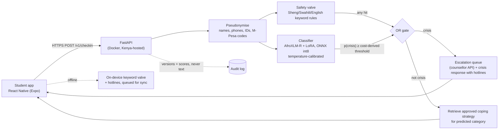

# Sikiza: Sheng-Aware Distress Triage and Coping Support

**Sikiza** (Swahili: "listen") is my DSA 8401 capstone. This repo is an end-to-end implementation of the proposal: a classifier for
English–Swahili–Sheng student check-ins that sends crisis messages to a human and answers every
other message with a **retrieved**, counsellor-approved coping strategy.

> **Status:** the code is complete and tested, and the models are trained and evaluated on **884 real
> messages from students at Kenyan universities** (Zindi BNBR Tech4MentalHealth, relabelled for this
> task). Those messages are in English; Swahili/Sheng performance is still only exercised on synthetic
> data. Before any student uses it: human review of the labels, counsellor approval of the library,
> and student/counsellor review of the Sheng lexicon. See "Before a pilot" below.

## Data

| Dataset | Use | Where |
|---|---|---|
| **Zindi: Basic Needs Basic Rights Kenya – Tech4MentalHealth** (2020). 925 statements and questions written by students at Kenyan universities, originally tagged Depression / Alcohol / Suicide / Drugs. Redistributed here under the dataset's terms; credit to Zindi and BNBR Kenya. | Real seed, training **and** test data | `data/zindi/Train.csv`, `Test.csv` (original files) |
| Sikiza labels: crisis (0/1) + one of six categories for every message, from the text alone | Labels | `data/labels/zindi_labels.csv`, guide in [`data/labels/LABELLING_GUIDE.md`](data/labels/LABELLING_GUIDE.md) |
| Prepared seed (duplicates merged, 884 messages) | Model input | `data/zindi/zindi_seed.csv` (`make data`) |
| Synthetic English/Swahili/Sheng check-ins (224) | Pipeline smoke tests; code-mixed tokenizer and drift checks only | `data/demo/demo_seed.csv` (`--demo`) |
| GoEmotions, AfriSenti-swa, tabularisai Swahili sentiment | Optional stage-1 fine-tuning (`--intermediate`) | downloaded from Hugging Face |

The first-pass labels were suggested by an AI assistant and are being reviewed (see [`AI_USE.md`](AI_USE.md));
the `reviewed` column records progress.

## Submission contents

| Deliverable | Where |
|---|---|
| Project overview, setup, architecture diagram, reproduction | this README |
| AI-use disclosure | [`AI_USE.md`](AI_USE.md) |
| Final report: problem framing, technique justification, results, limitations | [`REPORT.md`](REPORT.md) |
| Data pipeline (scripted, reproducible) | `triage/data.py`, `triage/augment.py`, `triage/pseudonymise.py`, `scripts/make_demo_data.py`, `scripts/augment.py` |
| Model training code | `triage/baseline.py`, `triage/transformer.py`, `triage/calibration.py`, `triage/thresholds.py`, `scripts/train_*.py`, `scripts/export_onnx.py` |
| Serialized artifacts | `artifacts/baseline/` (TF-IDF + LR, in the repo); int8 ONNX bundle in the [v0.2.0 release](https://github.com/Sheenaz/sikiza/releases/tag/v0.2.0) (`make model`, 279 MB, too large for git) |
| Evaluation outputs | `artifacts/reports/` (`eval.md`, `eval.json`, confusion matrices, fertility, drift) |
| Docker | `serving/Dockerfile`, `docker-compose.yml` |
| API service | `serving/app.py` (FastAPI) |
| Client app | `mobile/` (Expo React Native) |
| Tests and CI | `tests/`, `.github/workflows/ci.yml` |

## Architecture



Training side: seed check-ins → pseudonymise → grouped split by `seed_id` (train / calib / test) →
augment train only → baseline and LoRA fine-tuning → temperature scaling and threshold on calib →
ONNX int8 export, re-calibrated → evaluation on real (non-augmented) test messages only.

## Reproduce

Requirements: Python 3.11, Docker; Node 20+ only for the mobile app.

**A. Run the trained service (about 5 minutes)**

```bash
git clone https://github.com/Sheenaz/sikiza.git && cd sikiza
make model                      # download the int8 ONNX bundle from the release (SHA-256 checked)
docker compose up --build       # API on http://localhost:8000, interactive docs at /docs
curl -s -X POST localhost:8000/v1/checkin -H 'content-type: application/json' \
     -d '{"text":"nimechoka na exams, sijui kama nitapass"}'
```

**B. Rebuild everything from scratch on the real data (about 1 hour on a laptop CPU)**

## Proposal → code map

| Proposal item | Where |
|---|---|
| Crisis + 5 categories | `configs/config.yaml` `labels`; two-head model in `triage/transformer.py` |
| Pseudonymise (names, numbers) | `triage/pseudonymise.py`, `data/lexicon/names.txt` |
| Safety valve: keywords **OR** classifier | `triage/safety_valve.py`, `data/lexicon/sheng_lexicon.yaml`, `triage/pipeline.py::decide` |
| Augmentation, variants keep seed ID, grouped splits | `triage/augment.py`, `triage/data.py` (`make_splits`, `assemble`) |
| Test on real messages only | `data.assemble`: augmented rows only join train; asserted in `scripts/evaluate.py` |
| TF-IDF + LR baseline | `triage/baseline.py`, `scripts/train_baseline.py` |
| Zero-shot NLI check | `scripts/zero_shot.py` |
| AfroXLM-R / XLM-R + LoRA, DistilBERT comparison | `triage/transformer.py`, `scripts/train_transformer.py --model afroxlmr\|xlmr\|distilbert` |
| HF intermediate fine-tuning (GoEmotions, AfriSenti, tabularisai) | `triage/hf_data.py`, `--intermediate` |
| Measure tokenizer fertility first | `scripts/fertility.py` |
| Temperature scaling on held-out split | `triage/calibration.py` |
| Cost-derived threshold (not 0.5) | `triage/thresholds.py` |
| Retrieval from approved library, never generated | `triage/retrieval.py`, `data/library/coping_library.yaml` |
| Recall ≥ 0.95 with bootstrap CI, macro-F1, confusion matrix, EN vs code-mixed, McNemar, Cohen's κ | `triage/evaluate.py`, `scripts/evaluate.py` |
| ONNX int8 | `triage/export.py`, `scripts/export_onnx.py` |
| FastAPI + Docker, versions logged, never the raw message | `serving/app.py`, `serving/Dockerfile`, `triage/audit.py` |
| Human handles every crisis | escalation queue + counsellor endpoints in `serving/app.py` |
| Offline safety valve in the app | `mobile/src/safetyValve.ts` (parity-checked against Python) |
| Monthly drift checks for new Sheng | `triage/drift.py`, `scripts/drift_report.py`, OOV counter in `triage/audit.py` |
| < 400 ms round trip | `scripts/benchmark_latency.py`; dev builds of the app show ms per check-in |

```bash
make setup          # Python venv (+ mobile deps)
make real           # Zindi → prepare → augment → baseline → AfroXLM-R + DistilBERT → ONNX int8 → evaluate,
                    # fertility, zero-shot, drift; results in artifacts/reports/
make demo           # the same pipeline on the synthetic set (5 min smoke test)
make test           # unit + API tests
make serve          # API on :8000 without Docker (draft library allowed in dev)
cd mobile && cp .env.example .env && npx expo start      # app; set EXPO_PUBLIC_API_URL in .env
```

Every script prints a **DEMO DATA** banner when it runs on the synthetic set.

## Running on the Strathmore check-ins (when available)

1. Put the consented, de-identified check-ins at `data/raw/strathmore_checkins.csv` (git-ignored) and
   point `data.seed_csv` in `configs/config.yaml` at it.
   Columns: `seed_id, text, category, crisis, language` (+ `category_2, crisis_2` for the double-coded
   sample, which gives Cohen's κ). Use `en | sw | sheng | mixed` for `language`.
2. `python scripts/augment.py` (add `--back-translate` for MarianMT en↔sw round trips).
3. `python scripts/fertility.py`: record this before choosing the encoder.
4. `python scripts/train_baseline.py`
5. `python scripts/train_transformer.py --model afroxlmr --intermediate` (then `--model distilbert`)
6. `python scripts/export_onnx.py --src artifacts/afroxlmr_torch --out artifacts/model`
7. `python scripts/evaluate.py --bundles artifacts/baseline artifacts/afroxlmr_torch artifacts/distilbert_torch artifacts/model`
   gives `artifacts/reports/eval.md`, `eval.json` and the confusion matrices.
8. `python scripts/zero_shot.py`

Splits are fixed the first time (`data/processed/splits/splits.json`). The splits are never re-drawn once test results have been seen.

## Findings

The full discussion is in [`REPORT.md`](REPORT.md). In short:

1. **The source labels were unfit for crisis detection.** Zindi's "Suicide" tag agrees with text-based crisis
   labels at only κ = 0.45. Half of its "Suicide" messages are not crises, and 29 real crises were tagged
   "Depression". Every message was relabelled from its text; crisis labels were human-reviewed (κ = 0.74 between
   the AI first pass and the review).
2. **Duplicates leak across the official split.** 13 texts appear in both Zindi's train and test files. Identical
   texts are merged before the grouped split.
3. **Results on 221 real test messages (26 crises).** The deployed AfroXLM-R int8 model catches 24/26 crises
   (exact 95% CI 0.75–0.99) while escalating 38% of messages; the TF-IDF baseline catches 26/26 only by
   escalating 72%. AfroXLM-R is the best category model (macro-F1 0.66 vs 0.47, McNemar p = 0.013). On threshold-free
   ranking (ROC-AUC ≈ 0.92–0.93) the models are statistically indistinguishable on this English data.
4. **The keyword valve alone catches only 8/26 real crises.** Real students phrase crises indirectly ("is life
   even worth it"), so the classifier half of the OR-gate is essential.
5. **The success criterion needs more crisis examples than a random split gives.** Proving a 95% lower bound
   ≥ 0.95 needs **≥ 72 test crises with zero misses** (exact Clopper–Pearson). The real test set has 26.
   Always report the escalation rate next to recall: recall at a very high escalation rate means little.
6. **Drift detection must be calibrated on real text.** A fixed 25% unseen-word rule flagged 16% of ordinary
   held-out messages (typos, run-on words). Calibrated by cross-validation, the no-drift control flags ~2% while a
   shift to Sheng/Swahili flags ~73% and surfaces the new words.
7. **Tokenizer fertility** (code-mixed synthetic text): AfroXLM-R/XLM-R 1.57 tokens per word vs multilingual
   DistilBERT 1.93; on the real English text all three are ~1.24.
8. **int8 quantisation shifts logits**, so the int8 bundle is re-calibrated and re-thresholded on its own outputs
   (1.1 GB → 279 MB). Latency is ~5 ms per message on an M1 CPU; the 400 ms budget is network-bound.

## Docker

```bash
make model                       # or train it yourself: make demo
docker compose up --build -d     # builds sikiza:0.1.0 and starts it on :8000
docker compose logs -f api       # startup warnings (draft library, unreviewed lexicon, demo model)
docker compose down              # stop (the state volume is kept)

# Production: create .env with ALLOW_DRAFT_LIBRARY=0 and a strong COUNSELLOR_API_KEY.
# The container then REFUSES to start until the library is approved.
# Kenya-hosted cloud VMs are usually x86, so build for that platform:
docker buildx build --platform linux/amd64 -f serving/Dockerfile -t sikiza:0.1.0-amd64 .
```

Only the files allow-listed in `.dockerignore` are sent to the build: no data, no venv, no torch checkpoint.

- Image: about 450 MB compressed (python:3.11-slim + onnxruntime + int8 model, no torch). It runs as non-root
  uid 10001, the model is read-only, and it has a built-in health check.
- State (prediction log + escalation SQLite) lives on the `/app/state` volume. Back it up and set its
  retention according to the ethics approval.
- Memory: about 1.4 GB with 2 uvicorn workers (each loads the model). Use `--workers 1` on small VMs.
- Measured on an M1 through Docker Desktop: p50 25 ms and p95 37 ms HTTP round trip.
- The image bakes in whatever is in `artifacts/model` at build time. Rebuild after every re-export,
  and check `GET /v1/version` shows the expected model, lexicon and library versions.

## Privacy and governance (DPA 2019)

- Pseudonymisation runs first, at data load and at serving time. Its limitation: names that aren't
  introduced ("my name is…") and aren't in `names.txt` survive. The gazetteer is to be extended from the real data.
- The prediction log (`artifacts/logs/predictions.jsonl`) holds versions, scores and rule IDs, **never text**.
- The escalation queue (SQLite) holds the **pseudonymised** text, because a counsellor needs it to act.
  It's behind `COUNSELLOR_API_KEY`. Set retention to match the ethics approval.
- The OOV counter shows a new token only after it appears in ≥ 5 requests (k-anonymity floor).
- Host the Docker image on Kenya-based infrastructure.
- The webhook (`ESCALATION_WEBHOOK`) sends only the escalation ID, never message content.

## Before a pilot (blocking)

- [ ] Counselling department approves every entry in `data/library/coping_library.yaml`
      (`approved: true`, `approved_by`, `approved_on`) **and verifies every hotline number**.
      The API refuses unapproved entries unless `ALLOW_DRAFT_LIBRARY=1`.
- [ ] Counsellors **and** a student panel review `data/lexicon/sheng_lexicon.yaml`, then fill in `reviewed_by`.
      It is my starter list. It is not validated Sheng.
- [ ] Ethics approval, consent flow, retention policy, on-call counsellor rota for escalations.
- [ ] Real-data evaluation meets the recall target with an honest CI (Finding 1).
- [ ] `/health` returns no warnings.

## Known gaps / next steps

- **Only the keyword valve runs on the phone, not the int8 model.** Running the model on-device needs
  `onnxruntime-react-native` plus an XLM-R tokenizer in JS and an Expo development build (not Expo Go).
  The offline path covers the safety-critical part (keywords → crisis response + hotlines), and offline
  crisis check-ins are queued and sent when the phone reconnects.
- The optional LLM rephrase step is **not** implemented. Responses are verbatim library text, which is
  the safest option and the auditable default.
- Training on the Apple GPU (MPS) needs macOS ≥ 15 with this PyTorch version. On older macOS it falls back
  to CPU automatically. Override with `TRIAGE_DEVICE=cpu|mps|cuda`.
- Back-translation uses `Helsinki-NLP/opus-mt-en-swc` / `swc-en`. Spot-check its quality on Sheng.
